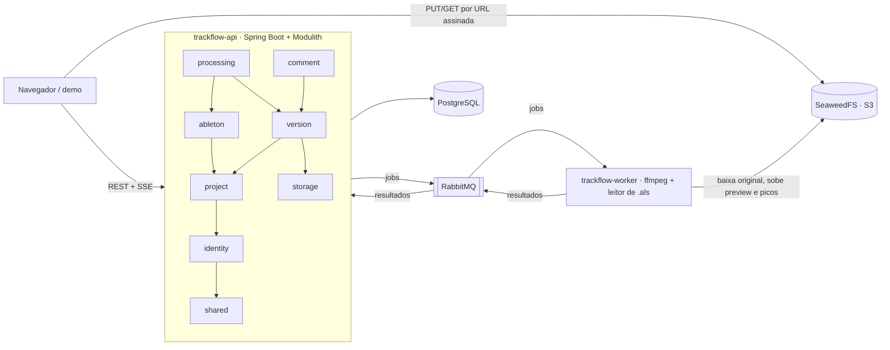

# Trackflow

[](https://github.com/HigorPassarela/TrackFlow/actions/workflows/ci.yml)

Plataforma de colaboração para produtores musicais: cada projeto é uma faixa, cada versão é um bounce processado de forma assíncrona e comentado em pontos exatos da forma de onda.

- **Versões numeradas**: o bounce vai direto do navegador para o storage por URL pré-assinada; a API só confirma.
- **Processamento assíncrono**: o worker gera o preview em MP3, a forma de onda, o BPM estimado, o loudness (LUFS) e o true peak.
- **Comentários no tempo**: cada comentário aponta um milissegundo da faixa, com respostas, resolução e filtro de pendentes.
- **Projetos do Ableton**: o `.als` enviado junto vira um snapshot (tempo, faixas, devices, plugins) e duas versões podem ser comparadas.
- **Colaboração**: papéis (dono, editor, ouvinte), convites e links de audição; status em tempo real por SSE.

<!-- GIF da demo: gravar a página http://localhost:8080 e salvar em docs/demo.gif -->

## Arquitetura



Três módulos Maven: `trackflow-api`, `trackflow-worker` e `trackflow-contracts` (os records das mensagens entre os dois). A API publica os jobs pelo registro de eventos do Spring Modulith depois do commit, então nada se perde se o broker cair; o worker reprocessa com retry e, quando desiste, devolve um resultado de falha para a versão não ficar presa em processamento.

### Módulos da API

| Módulo | Responsabilidade | Depende de |
|---|---|---|
| `shared` | erros (ProblemDetail), config web, `Clock`, tokens | — |
| `identity` | usuários, login OAuth2 e de desenvolvimento | shared |
| `project` | projetos, membros, papéis, convites, `ProjectAccess` | identity, shared |
| `storage` | port `ObjectStorage` + adapter S3 | shared |
| `version` | versões, upload, numeração, reprodução, links de audição, SSE | project, storage, identity, shared |
| `processing` | envio de jobs ao worker e recepção dos resultados | version, ableton, shared |
| `comment` | comentários marcados no tempo | version, project, identity, shared |
| `ableton` | snapshots dos `.als` e diff entre versões | project, identity, shared |

O `ModularityTest` falha se algum módulo importar um subpacote interno de outro ou criar um ciclo. Os diagramas gerados ficam em [`docs/modules/`](docs/modules/).

### Decisões principais

O raciocínio completo está em [`design.md`](openspec/changes/add-trackflow-mvp/design.md). Em resumo:

- **Monólito modular em vez de microsserviços** (D2): fronteiras verificadas em teste, um deploy só.
- **Ports só nas fronteiras de infraestrutura** (D3): storage, broker e ffmpeg; CRUD fica em `web → application → domain`.
- **Upload direto ao storage** (D4): o arquivo nunca passa pela API.
- **Entrega confiável de jobs** (D6) e **resultados idempotentes** (D8): resultado repetido ou atrasado não muda uma versão já concluída.
- **Pipeline do worker com ffmpeg** (D7) e **leitura de `.als` por StAX** (D10), com DTD e entidades externas desligadas.
- **Não membro recebe 404** (D11, D14): a API não revela que um projeto existe.
- **Testes com infraestrutura real** (D15): Testcontainers para PostgreSQL, RabbitMQ e SeaweedFS.

## Rodando localmente

Pré-requisitos: JDK 25, Docker e (para os testes do worker) ffmpeg.

```bash
cp .env.example .env                                  # valores locais; ajuste se quiser
docker compose --env-file .env -f docker/compose.yaml up -d
set -a; source .env; set +a                           # o worker não tem padrão para as chaves do storage
./mvnw -B -q install -DskipTests                      # uma vez: instala o POM pai e os contratos para o -pl
./mvnw -pl trackflow-api spring-boot:run -Dspring-boot.run.profiles=local
./mvnw -pl trackflow-worker spring-boot:run           # em outro terminal; precisa do ffmpeg no PATH
```

Com os dois no ar, a página de demonstração fica em <http://localhost:8080>: login de desenvolvimento, projetos, upload, player com forma de onda e comentários. É uma página estática sem build (`trackflow-api/src/main/resources/static/`), feita para testar o fluxo à mão, não um frontend de produto.

O worker também tem imagem própria, com o ffmpeg incluído:

```bash
docker build -f trackflow-worker/Dockerfile -t trackflow-worker .
```

O `docker/compose.yaml` também funciona sem `.env`: os padrões são os mesmos valores do `.env.example`.

## Login de desenvolvimento

No profile `local` existe um login sem provedor externo, para usar a API sem criar apps OAuth. Fora desse profile a rota responde 404.

Toda requisição que altera estado precisa do token CSRF. O token chega no cookie `XSRF-TOKEN` e volta no cabeçalho `X-XSRF-TOKEN`:

```bash
# 1. Pega o cookie XSRF-TOKEN
curl -s -c cookies.txt http://localhost:8080/actuator/health > /dev/null
XSRF=$(awk '$6 == "XSRF-TOKEN" { print $7 }' cookies.txt)

# 2. Entra como "produtor-a" (a conta de teste é criada no primeiro uso)
curl -s -b cookies.txt -c cookies.txt \
  -H "X-XSRF-TOKEN: $XSRF" -H "Content-Type: application/json" \
  -d '{"name": "produtor-a"}' \
  http://localhost:8080/api/dev/login

# 3. A sessão vale para as próximas chamadas
curl -s -b cookies.txt http://localhost:8080/api/me
```

O nome aceita letras minúsculas, dígitos e hífen (2 a 60 caracteres). O mesmo nome sempre entra na mesma conta.

## Login com GitHub

1. Em <https://github.com/settings/developers>, clique em **New OAuth App**.
2. Preencha:
   - **Application name**: `Trackflow (local)`
   - **Homepage URL**: `http://localhost:8080`
   - **Authorization callback URL**: `http://localhost:8080/login/oauth2/code/github`
3. Depois de criar, gere um **client secret**.
4. No `.env`, preencha `TRACKFLOW_GITHUB_CLIENT_ID` e `TRACKFLOW_GITHUB_CLIENT_SECRET`.
5. Exporte as variáveis antes de subir a API (o Spring não lê o `.env` sozinho):

   ```bash
   set -a; source .env; set +a
   ./mvnw -pl trackflow-api spring-boot:run -Dspring-boot.run.profiles=local
   ```

6. Abra <http://localhost:8080/oauth2/authorization/github>. Depois de autorizar, a conta é criada e a sessão começa.

## Login com Google

Mesmo fluxo, no [Google Cloud Console](https://console.cloud.google.com/apis/credentials): crie um **OAuth client ID** do tipo *Web application* com o redirect `http://localhost:8080/login/oauth2/code/google` e preencha `TRACKFLOW_GOOGLE_CLIENT_ID` e `TRACKFLOW_GOOGLE_CLIENT_SECRET`.

Contas de provedores diferentes nunca são unidas pelo e-mail: entrar pelo GitHub e pelo Google com o mesmo e-mail cria duas contas.

## Encerrar a sessão

```bash
curl -s -b cookies.txt -H "X-XSRF-TOKEN: $XSRF" -X POST http://localhost:8080/logout   # 204
```

## Testes

```bash
./mvnw -B verify                                     # build + testes + Spotless + ModularityTest
./scripts/smoke.sh                                   # ponta a ponta: sobe tudo, envia um WAV, espera READY e comenta
openspec validate add-trackflow-mvp --strict         # valida a change do OpenSpec
```

O `verify` usa Testcontainers (precisa do Docker) e roda os testes marcados com `ffmpeg`, que precisam do `ffmpeg` e do `ffprobe` no PATH. O `smoke.sh` precisa também de `curl` e `jq`.

## Como o projeto é construído

Toda mudança de comportamento começa no [OpenSpec](openspec/): proposta, specs com cenários, design e tarefas. O MVP está em [`openspec/changes/add-trackflow-mvp/`](openspec/changes/add-trackflow-mvp/). As convenções de código ficam em [`.claude/skills/trackflow-code-style/`](.claude/skills/trackflow-code-style/).
